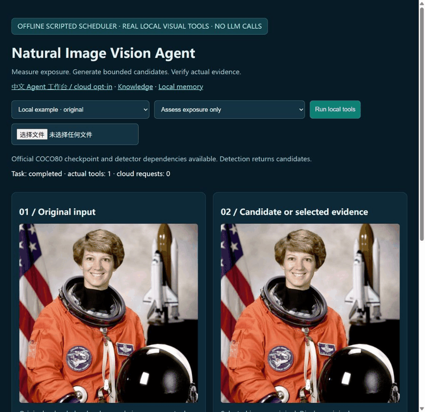
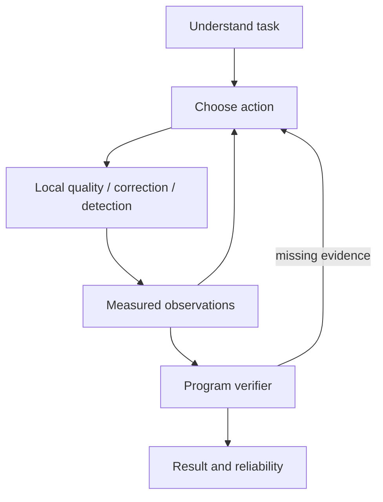

# General Image Analysis Agent

**Exposure assessment, bounded correction and evidence-checked detection for ordinary photographs.**

[中文操作](docs/QUICK_START_ZH.md) · [Architecture](docs/GENERAL_IMAGE_AGENT.md) · [MIT](LICENSE)



The workbench accepts 8-bit JPEG/PNG photos. A local official COCO detector supports 80 common object categories with Chinese aliases. Images stay local; the optional cloud model receives task text and tool observations. Detector scores are candidate scores, not correctness probabilities.

## Quick Start

Python 3.11, CPU; the exposure demo needs no model weights or API key:

```powershell
git clone https://github.com/sadbrand11-blip/underwater-vision-agent.git
cd underwater-vision-agent
python -m venv D:\CodexData\optical_agent\public\venv
$agentPython = "D:\CodexData\optical_agent\public\venv\Scripts\python.exe"
& $agentPython -m pip install -r requirements-demo.txt
& $agentPython run_demo.py
```

Open **http://127.0.0.1:7860/showcase**. Upload a photo or use the local example. Without a prepared photo the example is an explicitly labeled procedural exposure fixture. Missing detection is reported as unavailable.

For real detection, install `requirements-detector.txt`, then run `python run_demo.py --with-detector`. This verifies the official COCO checkpoint SHA256. Use `--port 7861` when needed. The `/agent` page provides Chinese tasks and follow-ups; cloud scheduling is opt-in and may incur charges. [Exact instructions](docs/QUICK_START_ZH.md).

## Evidence-driven execution



Native remains the default; optional LangGraph executes the same stages. Versioned local RAG and SQLite memory provide context. An independent MCP server exposes three tools. Quality-only tasks do not load a detector.

## Versioned evaluation

| 0.6.0 measurement | Result and scope |
|---|---|
| COCO detection | AP 24.12%, AP50 39.46%; 1,000 held-out project-split images |
| Runtime equivalence | Native/LangGraph 3/3 deterministic real-vision cases |
| MCP transport | 3 tools; 9/9 direct/protocol checks |

0.6.0 uses a new general-photo profile, corpus and memory namespace. Its [evaluation report](docs/GENERAL_EVALUATION.md) separates COCO ground-truth results, simulated exposure diagnostics, offline runtime tests and unavailable SICE experiments. A development gate determines whether correction can become the default selected image. Explicit candidate comparison remains available.

## Boundaries

Supported categories are listed in `/api/capabilities`. Medical images, remote sensing, tiny industrial defects and arbitrary text-described objects need separate models and validation. Enhancement cannot establish lost texture; calibration does not guarantee transfer to enhanced or out-of-domain photos. No-target output does not prove absence.

The original underwater release and scores remain [archived](docs/ARCHIVE_UNDERWATER.md). They do not describe this version. [Experiments](docs/CLI_MIGRATION.md) · [Optional components](docs/OPTIONAL_MODES.md) · [Source notices](THIRD_PARTY_NOTICES.md).
